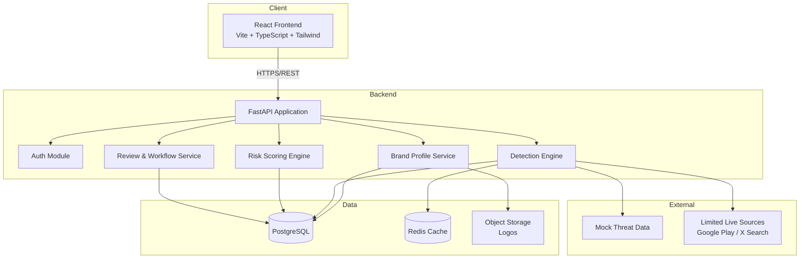

# Technical Design Document (TDD)
## BrandGuard – Digital Risk Protection Platform
### Social & App Monitoring

**Document Version:** 1.0  
**Date:** 12 October 2026  
**Author:** Staff Software Architect  
**Status:** Draft for Hackathon MVP  
**Related Documents:** BrandGuard PRD v1.0

---

## 1. System Overview & Architecture

### 1.1 Purpose
BrandGuard is a Digital Risk Protection platform that allows organizations to define their legitimate brand assets and automatically detect potential impersonations across social media platforms and mobile app stores. The system prioritizes threats using multi-signal risk scoring and ensures official assets are never flagged.

### 1.2 High-Level Architecture



### 1.3 Core Request Flow

1. Analyst creates / updates Brand Profile (name, logo, official social accounts, official apps).
2. Official assets are persisted and marked as excluded.
3. On-demand or scheduled detection job is triggered.
4. Detection Engine:
   - Generates look-alike name variants.
   - Matches against mock + limited live data sources.
   - Computes name, logo, description, and publisher similarity.
   - Excludes any asset that matches an official record.
5. Risk Scoring Engine produces a weighted 0–100 score with signal breakdown.
6. Results are stored and surfaced on the Dashboard, sorted by risk.
7. Analyst reviews items and updates status (Reviewed / False Positive / Escalated).

---

## 2. Technology Choices & Justifications

| Layer              | Choice                          | Justification                                                                 | Trade-offs |
|--------------------|---------------------------------|-------------------------------------------------------------------------------|----------|
| Backend Framework  | Python 3.12 + FastAPI           | Excellent performance, native async, automatic OpenAPI docs, rich ecosystem for text/image similarity | Slightly higher memory than Go; team familiarity assumed high |
| Frontend           | React 18 + TypeScript + Vite + Tailwind + shadcn/ui | Fast development, type safety, modern component library, excellent DX for dashboards | Bundle size managed via Vite code-splitting |
| Primary Database   | PostgreSQL 16                   | Relational integrity for brand assets & detections, strong JSON support, mature indexing | Requires careful schema design for high-volume detections |
| Cache              | Redis 7 (optional for MVP)      | Fast look-alike variant caching and session storage                           | Can be omitted in pure hackathon mode if time is short |
| Object Storage     | Local filesystem / Cloudinary / S3-compatible | Simple logo storage; Cloudinary gives free tier + transformations             | Local is fine for demo |
| Similarity Libraries | rapidfuzz, imagehash, Pillow   | Battle-tested, fast, no heavy ML dependencies required for MVP                | Homoglyph coverage limited without additional libraries |
| Auth               | JWT (python-jose) + passlib     | Stateless, simple to implement for multi-user demo                            | No SSO / enterprise IdP in Phase 1 |
| Deployment         | Docker + Render / Railway + Vercel | Zero-config for hackathon, free tiers, easy rollback                          | Not production-grade multi-region |

**Key Decision:** Python was chosen over Node.js because the detection logic (fuzzy matching, perceptual hashing, future embedding work) is significantly more productive in the Python ecosystem.

---

## 3. Component-Level Design & Module Responsibilities

### 3.1 Frontend (`/frontend`)
- **Brand Profile Module**: Form for creating/editing brand, logo upload, official accounts & apps management.
- **Dashboard Module**: Overview cards, risk distribution charts, filterable detection table.
- **Detection Detail View**: Side-by-side comparison (official vs. detected), signal breakdown, status actions.
- **Auth Module**: Login / protected routes.

### 3.2 Backend Services (`/backend/app`)

| Module                    | Responsibility |
|---------------------------|--------------|
| `api/v1/brand.py`         | CRUD for Brand Profile and official assets |
| `api/v1/detections.py`    | List, filter, get detail, update status of detections |
| `api/v1/auth.py`          | Login, token refresh, current user |
| `services/brand_service.py` | Business logic for brand & asset management |
| `services/detection_engine.py` | Orchestrates name, logo, description, publisher checks |
| `services/lookalike.py`   | Generates and scores name variations |
| `services/scoring.py`     | Weighted risk score calculation + explanation |
| `services/logo_similarity.py` | Perceptual hash comparison |
| `core/config.py`          | Environment-based settings |
| `core/security.py`        | Password hashing, JWT handling |
| `db/`                     | SQLAlchemy models + session management |

### 3.3 Detection Engine Pipeline
```
Input: Brand Profile
  → Generate look-alike variants
  → Query mock data store + limited live sources
  → For each candidate:
      - Name similarity (rapidfuzz)
      - Logo similarity (imagehash)
      - Description / bio similarity
      - Publisher / developer mismatch check
      - Official asset exclusion check
  → Calculate composite risk score
  → Persist Detection + Evidence
```

---

## 4. Data Models & Schemas

### 4.1 Core Tables

```sql
-- Users
CREATE TABLE users (
    id              UUID PRIMARY KEY DEFAULT gen_random_uuid(),
    email           VARCHAR(255) UNIQUE NOT NULL,
    hashed_password VARCHAR(255) NOT NULL,
    full_name       VARCHAR(255),
    is_active       BOOLEAN DEFAULT TRUE,
    created_at      TIMESTAMPTZ DEFAULT NOW()
);

-- Brands
CREATE TABLE brands (
    id              UUID PRIMARY KEY DEFAULT gen_random_uuid(),
    owner_id        UUID NOT NULL REFERENCES users(id),
    name            VARCHAR(255) NOT NULL,
    normalized_name VARCHAR(255) NOT NULL,  -- lowercased, stripped
    logo_url        TEXT,
    website         VARCHAR(512),
    created_at      TIMESTAMPTZ DEFAULT NOW(),
    updated_at      TIMESTAMPTZ DEFAULT NOW()
);
CREATE INDEX idx_brands_owner ON brands(owner_id);
CREATE INDEX idx_brands_normalized_name ON brands(normalized_name);

-- Official Social Accounts
CREATE TABLE official_social_accounts (
    id              UUID PRIMARY KEY DEFAULT gen_random_uuid(),
    brand_id        UUID NOT NULL REFERENCES brands(id) ON DELETE CASCADE,
    platform        VARCHAR(50) NOT NULL,  -- 'x', 'instagram', 'facebook', etc.
    handle          VARCHAR(255) NOT NULL,
    url             TEXT,
    is_verified     BOOLEAN DEFAULT FALSE,
    created_at      TIMESTAMPTZ DEFAULT NOW(),
    UNIQUE(brand_id, platform, handle)
);
CREATE INDEX idx_official_social_brand ON official_social_accounts(brand_id);

-- Official Apps
CREATE TABLE official_apps (
    id              UUID PRIMARY KEY DEFAULT gen_random_uuid(),
    brand_id        UUID NOT NULL REFERENCES brands(id) ON DELETE CASCADE,
    name            VARCHAR(255) NOT NULL,
    package_id      VARCHAR(255),          -- com.nike.app
    developer_name  VARCHAR(255),
    store           VARCHAR(50) NOT NULL,  -- 'google_play', 'app_store'
    store_url       TEXT,
    logo_url        TEXT,
    created_at      TIMESTAMPTZ DEFAULT NOW()
);
CREATE INDEX idx_official_apps_brand ON official_apps(brand_id);

-- Detections
CREATE TABLE detections (
    id                  UUID PRIMARY KEY DEFAULT gen_random_uuid(),
    brand_id            UUID NOT NULL REFERENCES brands(id) ON DELETE CASCADE,
    source_type         VARCHAR(50) NOT NULL,  -- 'social' | 'app_store'
    platform            VARCHAR(50),           -- 'x', 'instagram', 'google_play', etc.
    title               VARCHAR(512) NOT NULL, -- account name or app name
    url                 TEXT,
    handle_or_package   VARCHAR(255),
    developer_or_owner  VARCHAR(255),
    description         TEXT,
    logo_url            TEXT,
    risk_score          NUMERIC(5,2) NOT NULL,
    risk_level          VARCHAR(20) NOT NULL,  -- 'high', 'medium', 'low'
    status              VARCHAR(30) DEFAULT 'needs_review', -- needs_review, reviewed, false_positive, escalated
    is_official_excluded BOOLEAN DEFAULT FALSE,
    raw_signals         JSONB,                 -- detailed signal scores
    created_at          TIMESTAMPTZ DEFAULT NOW(),
    updated_at          TIMESTAMPTZ DEFAULT NOW()
);
CREATE INDEX idx_detections_brand_risk ON detections(brand_id, risk_score DESC);
CREATE INDEX idx_detections_status ON detections(status);
CREATE INDEX idx_detections_source ON detections(source_type, platform);

-- Detection Evidence (optional detailed breakdown)
CREATE TABLE detection_evidence (
    id              UUID PRIMARY KEY DEFAULT gen_random_uuid(),
    detection_id    UUID NOT NULL REFERENCES detections(id) ON DELETE CASCADE,
    signal_type     VARCHAR(50) NOT NULL,  -- 'name_similarity', 'logo_similarity', etc.
    score           NUMERIC(5,2),
    explanation     TEXT,
    metadata        JSONB
);
```

### 4.2 Indexing Strategy
- Composite index on `(brand_id, risk_score DESC)` for the main dashboard query.
- Partial index on `status = 'needs_review'` if volume grows.
- GIN index on `raw_signals` JSONB if complex filtering is required later.
- Normalized name column + index for fast official asset lookups.

---

## 5. Security Architecture

### 5.1 Authentication & Authorization
- JWT-based authentication (access + refresh tokens).
- Passwords hashed with bcrypt (passlib).
- All brand and detection endpoints require a valid JWT.
- Row-level ownership: users can only access brands they own (enforced in service layer + optional RLS later).

### 5.2 Secrets Management
- All secrets loaded from environment variables (never committed).
- `.env` for local development; platform secrets (Render/Railway) for deployed environments.
- Database credentials, JWT secret, and any API keys stored as secrets.

### 5.3 OWASP Mitigations (MVP Focus)
| Risk                        | Mitigation |
|-----------------------------|----------|
| Injection                   | SQLAlchemy ORM + parameterized queries |
| Broken Authentication       | Short-lived JWTs + refresh token rotation |
| Sensitive Data Exposure     | HTTPS only; logos served via signed URLs if using S3 |
| Broken Access Control       | Ownership checks on every brand/detection operation |
| Security Misconfiguration   | CORS restricted to frontend origin; security headers via middleware |
| XSS                         | React escapes by default; avoid `dangerouslySetInnerHTML` |
| Insecure Deserialization    | Avoid pickle; use JSON only |

---

## 6. Error Handling, Logging, and Observability

### 6.1 Error Handling
- Global exception handlers in FastAPI for:
  - `RequestValidationError` → 422
  - `HTTPException` → passthrough
  - Unhandled exceptions → 500 with generic message (details only in logs)
- Domain-specific exceptions (e.g., `BrandNotFound`, `OfficialAssetConflict`) mapped to proper status codes.

### 6.2 Logging
- Structured JSON logging using `structlog` or standard `logging` with JSON formatter.
- Every request logs: `request_id`, `user_id`, `path`, `status_code`, `duration_ms`.
- Detection runs log start/end + number of candidates processed + high-risk count.

### 6.3 Health & Readiness
```
GET /health          → {"status": "ok"}
GET /ready           → checks DB connectivity (+ Redis if enabled)
```

### 6.4 Observability (Hackathon Level)
- Request ID middleware for correlation.
- Basic timing metrics for detection pipeline.
- Future: OpenTelemetry traces + Prometheus metrics.

---

## 7. Scalability & Performance Plan

### 7.1 Current MVP Targets
- Dashboard load < 3 seconds for a brand with ≤ 500 detections.
- Detection job for one brand completes in < 15 seconds (mock-heavy).

### 7.2 Performance Techniques
- **Database**: Connection pooling via SQLAlchemy (`pool_size=10`, `max_overflow=20`).
- **Caching**: Redis cache for look-alike variant generation and official asset sets (TTL 1 hour).
- **Async**: FastAPI async endpoints + `httpx` for any external calls.
- **Background Tasks**: Detection can run as FastAPI `BackgroundTasks` or simple Celery/RQ later.
- **Frontend**: Pagination + virtualized tables for large detection lists; React Query for caching.

### 7.3 Future Scaling Levers
- Move detection to a dedicated worker queue.
- Partition `detections` table by `brand_id` or time.
- Add read replicas for dashboard queries.
- Pre-compute look-alike variants on brand profile save.

---

## 8. Deployment & Migration Strategy

### 8.1 Containerization
- Multi-stage Dockerfile for backend (builder + slim runtime).
- Frontend built as static assets and served by CDN (Vercel) or Nginx.

### 8.2 Environments
| Environment | Frontend          | Backend             | Database      |
|-------------|-------------------|---------------------|---------------|
| Local       | Vite dev server   | Uvicorn             | Docker Postgres |
| Staging/Demo| Vercel            | Render / Railway    | Neon / Supabase |
| Production  | Vercel / CloudFront | ECS / Cloud Run   | RDS / Cloud SQL |

### 8.3 Database Migrations
- Alembic for schema migrations.
- Zero-downtime strategy:
  1. Expand (add new columns/tables as nullable).
  2. Deploy code that writes to both old & new.
  3. Backfill.
  4. Contract (remove old columns in later release).
- Rollback: Keep previous Docker image + previous Alembic revision; `alembic downgrade` if needed.

### 8.4 CI/CD (Recommended Minimum)
- GitHub Actions:
  - Lint + type-check (ruff, mypy, tsc)
  - Unit tests
  - Build Docker image
  - Deploy to Render/Railway on main branch

### 8.5 Demo Reliability Checklist
- Seed script with 1–2 realistic brands + 30–50 high-quality mock detections.
- Pre-warmed database.
- Fallback static screenshots if live detection fails during presentation.

---

## Appendix A – Suggested Repository Structure

```
brandguard/
├── backend/
│   ├── app/
│   │   ├── api/v1/
│   │   ├── core/
│   │   ├── db/
│   │   ├── models/
│   │   ├── schemas/
│   │   ├── services/
│   │   └── main.py
│   ├── alembic/
│   ├── tests/
│   └── Dockerfile
├── frontend/
│   ├── src/
│   │   ├── components/
│   │   ├── pages/
│   │   ├── hooks/
│   │   └── lib/
│   └── package.json
├── docker-compose.yml
└── README.md
```

---

## Appendix B – Open Technical Decisions

1. Exact weighting of risk score signals (to be tuned with sample data).
2. Whether to implement Redis in the MVP or defer.
3. Depth of live data integration vs. pure high-quality mocks for demo stability.
4. Logo similarity threshold tuning.

---

**Document Control**  
This TDD provides the technical blueprint for a 4-person hackathon team to deliver a focused, reliable, and demonstrable MVP of BrandGuard that aligns with the Product Requirements Document and maximizes evaluation scores.

**Next Recommended Artifacts**
- API contract (OpenAPI / Swagger)
- Detailed task breakdown per team member
- Seed data specification
- Demo script

---
*End of Technical Design Document*
```
